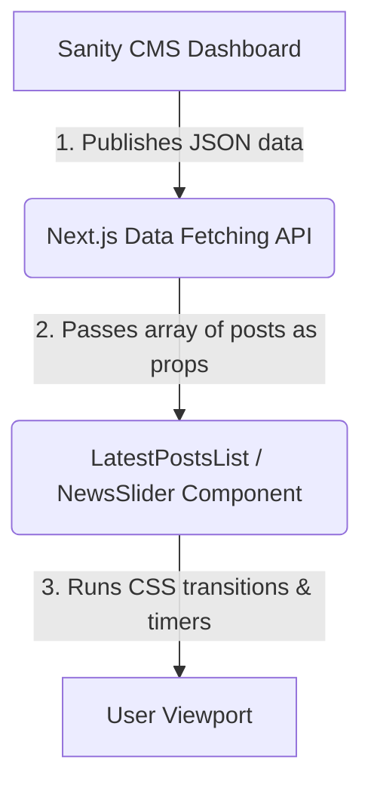

# Sanity CMS Integration Guide & Architecture Explanations

This document stores the design ideas and conceptual explanations regarding the future integration of Sanity CMS into the HexAstro blog. Use this as a reference when setting up your Headless CMS.

---

## 1. Frontend Layouts vs. CMS Data Roles

When you connect Sanity CMS, the codebase remains largely unchanged because of the **separation of concerns** between data and layout:



### What Sanity Handles (The Data):
* Storing text content (titles, summaries, and paragraphs).
* Storing dates, tags, and category labels.
* Uploading and hosting image assets (cover images).

### What Your Next.js Code Handles (The Presentation):
* **Transitions & Animations**: The smooth fade-in and horizontal translate transforms (`transform: translateX(20px)` to `translateX(0)`) belong entirely to the CSS/React code in the frontend.
* **Slider Timer Loops**: The `setInterval` timers (which cycle the active slide every 4 seconds) and indicator jump dots are frontend elements.
* **Layout Grid**: Rendering cards in 3 columns or showing full-page blurred modals.

*Summary: When you edit or add news items in Sanity, the changes appear on the live site automatically, and the sliding transitions will work out of the box.*

---

## 2. Managing "Featured" Posts

Currently, we define if an article is featured inside the local file's header frontmatter (`featured: true`). 

### How it works in Sanity:
To decide if an article or news item should be featured, you will add a `boolean` field to your Sanity schema:
```javascript
{
  name: 'featured',
  title: 'Featured Post?',
  type: 'boolean',
  initialValue: false
}
```
This creates a simple **toggle switch** next to each post inside your Sanity Studio browser dashboard. Toggling it ON and publishing will automatically show that post in the homepage featured widget, hiding it from the lower grid to prevent duplicates. No Git commits or local code changes are needed to feature a post.

---

## 3. Submissions & Editorial Review Pipeline

If you have multiple authors submitting articles, Sanity provides a built-in Drafts and Roles workspace workflow to manage review processes.

### Workflow A: Team Member Submissions (Invited Writers)
1. **Invite Writers**: You invite contributors to your Sanity Studio dashboard with "Contributor" or "Author" roles.
2. **Draft State**: When they write a post, Sanity saves it as a `draft` document. The author cannot publish it.
3. **Editor Review**: As the Editor/Admin, you open the Sanity Studio dashboard, check the draft, edit it if necessary, and toggle the "Featured" flag.
4. **Publish**: You click **Publish**. Sanity merges the draft into the production database, and it immediately goes live on the website.

### Workflow B: Public Submissions (Anyone on the Internet)
If you want guest readers to submit posts without joining your dashboard:
1. **Form Page**: We can create a public `/submit` form page on the blog website.
2. **API Endpoint**: When a reader clicks submit, our Next.js backend API pushes the form details directly to Sanity's API, creating a new document in the `draft` state.
3. **Admin Panel**: You log into Sanity Studio, inspect the guest's draft in your review inbox, and click **Publish** to make it live.

---

## 4. Renaming Content Streams & Sub-Menu Items

If you decide to rename the content types (e.g., changing "Research Papers" to "Research Briefs" or "Essays" to "Articles") in the future, you will need to update the names in these key files:

### A. Navigation Menu Labels
* **File**: [src/components/layout/Navbar.tsx](file:///Users/ashadahmad/Desktop/Asad/website/blog/src/components/layout/Navbar.tsx)
* Change the display strings inside the `.navbar-dropdown` div:
  ```tsx
  <div className="navbar-dropdown">
    <Link href="/posts?type=guide" className="navbar-dropdown-link">Guides</Link>
    <Link href="/posts?type=debrief" className="navbar-dropdown-link">Research Papers</Link>
    <Link href="/posts?type=exploration" className="navbar-dropdown-link">Essays</Link>
  </div>
  ```

### B. Filter Tab Labels & Router Mappings
* **File**: [src/components/article/LatestPostsList.tsx](file:///Users/ashadahmad/Desktop/Asad/website/blog/src/components/article/LatestPostsList.tsx)
* Update the filter pills list array (e.g., change `'Research Papers 📄'` to `'Research Briefs 📄'`):
  ```tsx
  ['Guides 🎓', 'Research Papers 📄', 'Essays ✍️']
  ```
* Update the corresponding state synchronization matching checks:
  ```typescript
  if (typeQuery === 'guide') return 'Guides 🎓'
  if (typeQuery === 'debrief') return 'Research Papers 📄'
  if (typeQuery === 'exploration') return 'Essays ✍️'
  ```

### C. Article Cards Badges
* **File**: [src/components/article/ArticleCard.tsx](file:///Users/ashadahmad/Desktop/Asad/website/blog/src/components/article/ArticleCard.tsx)
* Update the text returning helpers for overlays:
  ```typescript
  const getTypeBadgeText = (type?: ContentType) => {
    switch (type) {
      case 'guide': return '🎓 Guide'
      case 'debrief': return '📄 Research'
      case 'exploration': return '✍️ Essay'
    }
  }
  ```
